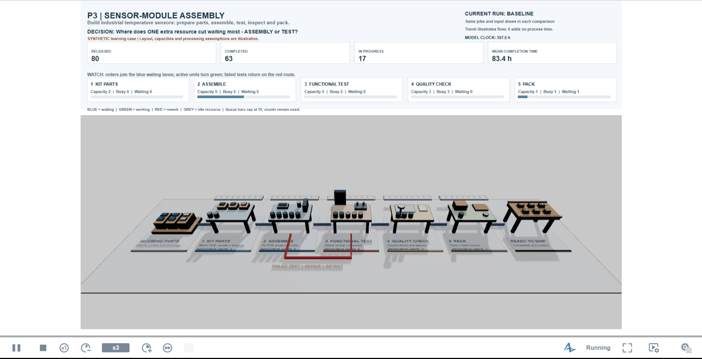

# Assembly capacity simulation

**One extra processing resource: should it go to Assembly or Test?**

A hypothetical manufacturer builds industrial temperature-sensor modules. This project
uses **AnyLogic discrete-event simulation and an independent Python replica** to compare
capacity decisions across preparation, assembly, testing, quality inspection and packing.
It measures waiting, queues, resource use and total order completion time.

**Entirely synthetic data · Educational project · Directed by Taim Salimoun**

## See the production-flow simulation in action



**[Watch / download the 32-second MP4](results/visual-final/sensor-line.mp4)** ·
[Full-resolution still](results/visual-final/sensor-line.png) ·
[Read the illustrated report (PDF)](model/Model-description.pdf)

This is a recording of the **running native AnyLogic model**: the final ~32 seconds of a
baseline run (seed 1, 80 orders, capacities 2/5/5/3/1, 10% assumed rework), ending at
**80 of 80 orders finished with zero work in progress**. The panel shows released,
completed and in-progress orders, mean completion time and each stage's capacity, busy
and waiting counts. Capture timing is reconstructed from saved-frame timestamps; see
[the acceptance record](results/visual-final/acceptance.json).

One visible product token represents a **work order**. Boards, housings and cartons explain
its progress; they are illustrative graphics. Blue indicates waiting, green processing,
and red a rework visit. A failed functional test returns the order to Assembly and then
Test. The dashboard reads actual simulated state. Visual movement adds no processing
delay, routing decision or random draw. The factory layout is schematic.

## What is modeled?

```text
Order + available kit → Prepare parts → Assembly → Test → Quality → Pack → Ship
                                           ↑       |
                                           └─ rework
```

Two unlimited FIFO buffers hold incoming orders and kit tokens. A real PML **Combine**
block synchronizes one order with one available kit. Each of the five **Service** blocks
seizes a resource from its corresponding **ResourcePool**, processes a visit, then releases
it. Rework repeats Assembly and Test. An independent-supply mode allows missing kits to
create additional waiting. One kit token is an abstraction, not a detailed bill of materials.

The experiment compares baseline with one extra resource per stage. Paired
scenarios receive the **same pre-drawn arrivals, work requirements and rework inputs**,
so capacity-dependent waiting cannot change which random inputs a job receives.

## Main finding — conditional on the assumptions

The main native confirmation favors **Assembly +1 over Test +1**:

| Completion-time metric | Assembly +1 advantage over Test +1 | 95% confidence interval |
|---|---:|---:|
| Mean lead time | **2.123 hours shorter** | **2.036–2.210 h** |
| P90 lead time | **3.707 hours shorter** | **3.504–3.911 h** |

This uses **200 fresh paired replication seeds per scenario**, 5,000 orders per run and
a frozen 500-job cutoff. Pilot runs are not pooled into confirmation. P90 means the
90th percentile of order completion times within each replication; its uncertainty is
measured across replication P90s.

The mean comparison meets the declared 5% relative-precision target. The P90 comparison's
relative half-width is **5.48%**, so it **misses** that target; its **0.203-hour absolute
half-width** meets the separate 0.5-hour tolerance.

**Other plausible capacity/service assumptions can reverse the capacity preference.**
The result supports an assumption-dependent comparison, not a universal instruction to
hire at Assembly. See the [full report](docs/report.md) for sensitivities and interpretation.

[Exact paired results](results/analysis/e2-confirmation/primary.csv) ·
[Scenario summaries](results/analysis/e2-confirmation/summary.csv) ·
[Native analysis acceptance](results/analysis/e2-confirmation/acceptance.json)

## Verification is different from validation

The source contains **200 synthetic orders; cleaning retains 195** after excluding three
missing-timestamp and two negative-duration records. Empirical and fitted input families
are compared, with distribution-fit limitations disclosed.

Native/Python checks compare actual order, visit and kit records. A recorded 120-case
new-feature comparison agrees within **1e-9 hours**. Queue benchmarks, conservation checks,
resource-hour limits and input-tape comparisons test whether the implementation follows
its rules. [Replica evidence](results/replica-v2-agreement.json) records that comparison;
final-canonical acceptance must be read separately from earlier source checkpoints.

**The observed-rate baseline fails the declared source mean/P90 accuracy bands:** simulated
mean **66.557 h** versus source **55.460 h**, and P90 **91.481 h** versus **73.863 h**.
Completion timestamps contain waiting as well as processing. Treating their differences
as service durations can add waiting twice. Real staffing, service starts, shifts, failure
rates and costs are unobserved; the source cannot identify a real staffing requirement.

## Explore the project

- [Model report](docs/report.md) and [PDF description](model/Model-description.pdf) — experiments, findings and limits.
- [Model design](docs/design.md) — queues, resources, kit synchronization and random streams.
- [3D guide](docs/3d-user-guide.md) — what the products, colors, dashboard and movement mean.
- [Native model](model/P3_Assembly_Flow.alp) and [AnyLogic guide](model/BUILD-IN-ANYLOGIC.md) — editor and experiment reference.
- [Experiment preregistration](docs/v2-preregistration.md) — frozen choices and disclosed amendments.
- `analysis/`, `results/analysis/`, `tests/` — calibration, replica, statistical analysis, evidence and verification tests.

## Repository map

| Folder | Purpose |
|---|---|
| `model/` | Native `.alp` model, AnyLogic guide, PDF report, canvas schematic |
| `tools/` | Model generator, native-run helpers, report and packaging scripts |
| `analysis/` | Calibration, independent Python replica, statistics and comparisons |
| `results/` | Aggregate native results, replica agreement, animation recording and evidence |
| `docs/` | Report, design notes, 3D guide, preregistration and queueing maths |
| `tests/` | Verification tests (run in CI) |

Multi-gigabyte native run logs and executed private model copies are **not** included;
the aggregate tables and acceptance records they produced are under `results/`.

## Reproduce and inspect

Use **Python 3.12**, from the repository root:

```bash
python -m venv .venv
# Activate .venv for your operating system, then:
python -m pip install -r requirements.txt
python -m pytest tests -q
```

The synthetic calibration source is `analysis/calibration/source-synthetic.xlsx`.
Python tests and analysis do not establish native visual acceptance. Tests requiring the
local AnyLogic Java compiler skip when it is absent. Native execution requires a separate
**AnyLogic 8.9 Personal Learning Edition** installation; no engine is redistributed.
Open `model/P3_Assembly_Flow.alp`: `Simulation` replays the 195 retained records, while
`Demo3D` presents the capacity scenario. Configure a scenario before starting and restart
for comparisons; editing a live run is not a matched experiment.

## Authorship and scope

**Claude/Codex agents produced the model, code, experiments and documentation under Taim
Salimoun's direction.** His independent editor rebuild remains a separate learning step.
This is a synthetic educational capacity study, not client work, a measured sensor factory,
or a verified commercial staffing recommendation. AnyLogic PLE educational-use terms apply.
