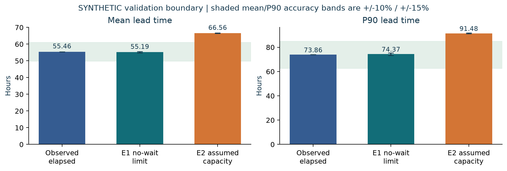
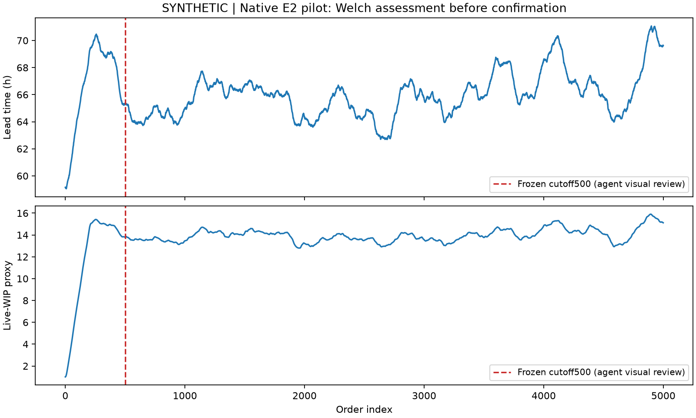
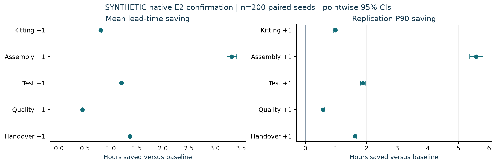
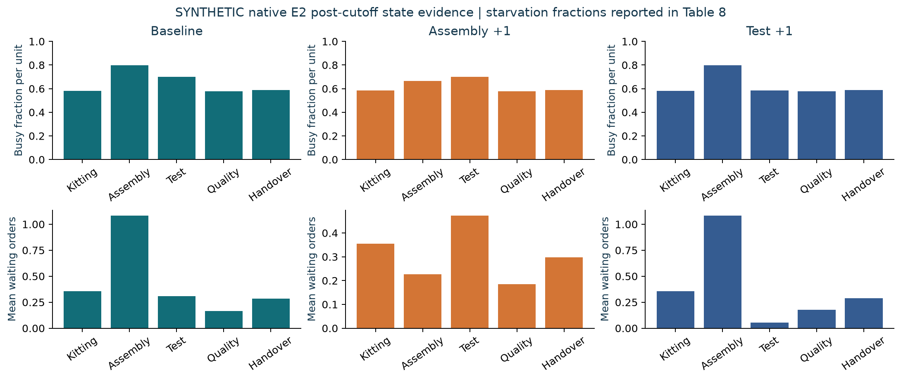
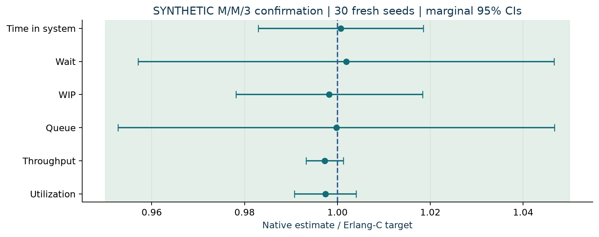
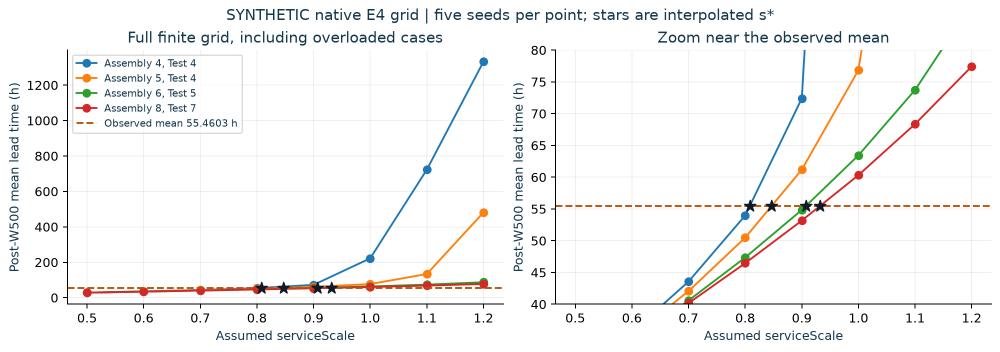
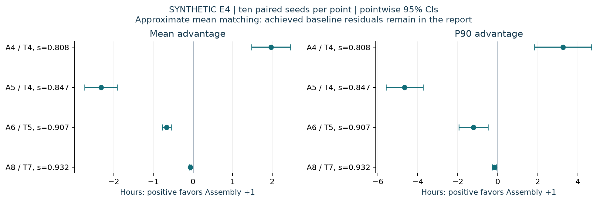
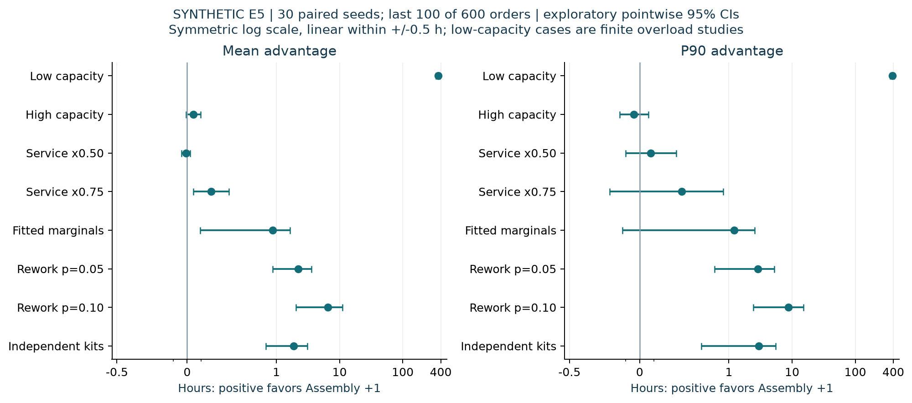
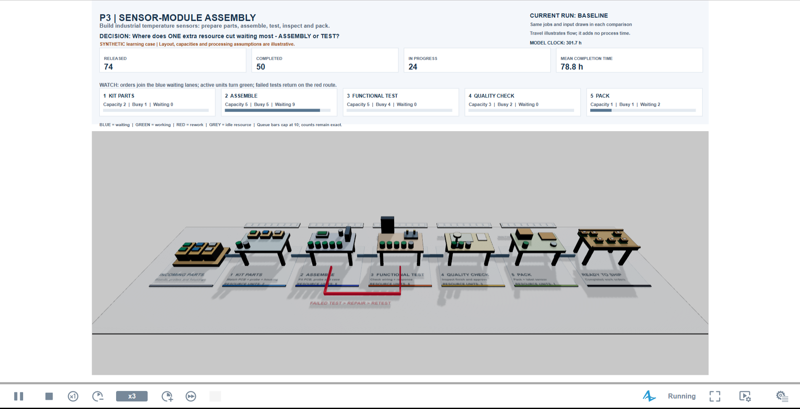

# P3 v2: sensor-module assembly and capacity

**SYNTHETIC DATA | AnyLogic PLE educational portfolio | Tier B: agent-produced under Taim Salimoun's direction**

Report date: 27 October 2026. A hypothetical manufacturer makes industrial temperature-sensor modules. Each work order prepares a kit, undergoes assembly and functional testing, passes quality inspection and is packed for shipment. A failed test returns to Assembly for repair and then repeats Test. One moving token represents a work order, not a measured individual-unit production run. This is P3, separate from the Rossmann P1 data pipeline and P2 replenishment model.

**Decision:** under stated queueing assumptions, should one extra processing resource go to Assembly or Test? The main native confirmation favors Assembly +1 on both mean and P90 lead time. The capacity/service-scale study reverses that ranking at three of four approximate mean-matching points. The recommendation is conditional on E2's assumptions, not identifiable from the observed data alone.

**Validation limit first:** source completion timestamps include processing and waiting. Actual service starts, staffing, shifts, failure rates, kit supply and costs are absent. Treating elapsed durations as service proxies can add waiting to times that already contain waiting. The assumed observed-rate baseline fails the declared source mean/P90 accuracy bands. The product story and animation do not resolve that identification problem.

**Evidence boundary:** numerical sections use actual native logs. E4's 120 contrasts and the final-canonical default/E2/combined-feature comparisons have completed. The redesigned native animation completed80/80orders and was recorded. Fresh-extracted native checks and archive integrity are separate evidence, with their precise scope in section12.

| Main result | Native evidence and interpretation |
|---|---|
| E2 baseline | Mean 66.557 h [66.380,66.735]; P90 91.481 h [91.112,91.850] |
| Assembly+1 versus Test+1 | Mean advantage 2.123 h [2.036,2.210]; P90 advantage 3.707 h [3.504,3.911] |
| Confirmation |200 fresh paired seeds per scenario;5,000 orders; cutoff W=500; pilot not pooled |
| Precision | Mean advantage relative half-width 4.10% passes. P90 advantage 5.48% misses 5%; its absolute half-width 0.203 h passes 0.5 h tolerance. |
| Queue verification | Fresh native M/M/3 confirmation passes all six analytic/error/precision checks. |
| Authorship | Agents produced the model, code, analysis and report under Taim's direction. His independent editor rebuild is separate. |

## 1. Requirements and responsibility

The original brief's aviation angle is an educational process-modeling motivation. No real Airbus data, factory model or company claim is used. The sensor narrative makes the same five-stage decision understandable.

| Original requirement | Where addressed |
|---|---|
|1. Verify input quality and exclusions | Section 2; source hash and retained/rejected records |
|2. Compare empirical, gamma, lognormal and Weibull inputs | Section 3; fitted parameters, selection and goodness of fit |
|3. Source/Combine/Service/resources/rework/Sink | Section 4; block and parameter description |
|4. Queue benchmarks, capacity bound and conservation | Sections 5 and 8; analytic and implementation checks |
|5. Paired capacity experiments, precision and Welch decision | Sections 6-7; all six scenarios, pilot/confirmation and amendments |
|6. Compare simulated and observed mean/P90 | Section 5; no-wait limit and observed-rate mismatch |
|7. Recommendation, costs and independent sensitivities | Sections 7-11; all five alternatives, five sensitivity axes |
|8. Model, canvas/animation, report, evidence and fresh extraction | Section 12; native evidence and delivery acceptance |
|9. Optional line-side replenishment | Not implemented. Independent kit arrivals are a supply sensitivity, not an(s,S) inventory policy. |

| Responsibility | Contribution |
|---|---|
| Taim Salimoun | Project direction and review; requested sensor story and clearer movement |
| AI agents under Taim's direction | Tier-B model/code production, native runs, analysis and report |
| Taim's own-it step | Independently rebuild and explain the core flow before claiming personal hands-on construction |

## 2. Synthetic source and identification boundary

The unchanged workbook sheet LeadTime_Analysis has 200 orders. Cleaning retains 195 whole orders: three missing-timestamp and two negative-duration records are excluded. Invalid elapsed records are removed from duration calibration; all 200 raw releases remain relevant for arrival-gap characterization. The portable package includes an unchanged copy at analysis/calibration/source-synthetic.xlsx; the model embeds its clean rows and needs no workbook at runtime. Source SHA-256: `b4c3af55f44f40fca0c9978f222016b9c44b7578209f118d04a843469458c00d`.

| Excluded order | Reason |
|---|---|
| ORD-0195 | Negative duration |
| ORD-0166 | Missing timestamp |
| ORD-0162 | Missing timestamp |
| ORD-0053 | Negative duration |
| ORD-0012 | Missing timestamp |

| Stage | Observed mean h | Observed P90 h | Sensor-story operation |
|---|---|---|---|
| Kitting |5.9069|9.0167|Prepare parts kit|
| Assembly |20.1762|27.3667|Fit board, probe and housing|
| Test |17.6735|33.8667|Check assembled module|
| Quality |8.7367|13.5133|Inspect and approve|
| Handover |2.9670|4.4267|Pack and label|
| End to end |55.4603|73.8633|Release to final completion|

Assembly's largest elapsed mean and Test's longest elapsed P90 motivate a comparison; neither identifies a capacity bottleneck. There are no observed queue entries, processing starts or resource occupancy. Service/wait decomposition and true capacities are not jointly identifiable from completion timestamps.

The 199 raw release gaps average 5.0540201005 h. The synthetic generator placed a fixed count uniformly over 42 days; it did not generate a Poisson process. E2 assumes exponential gaps matching that mean. Arrival and service-proxy assumptions are outside the simulation confidence intervals.

## 3. Calibrated inputs and fit limits

The analysis compared empirical, gamma, lognormal and Weibull families rather than replacing distributions by their means. The first 156 chronological clean rows trained candidates; the final 39 helped select families. Selected parametric families were refitted on all 195 clean rows for execution. The 39-row selection subset is not independent final validation.

| Stage | Executed family and parameters | Selection mean/P90 error | Fitted-null KS p |
|---|---|---|---|
| Kitting | Empirical type-1 quantile,195 retained durations |0.72% /7.71%|N/A|
| Assembly | Lognormal shape 0.304356, loc 0, scale 19.265425 h |4.05% /8.21%|0.960|
| Test | Weibull shape 1.697260, loc 0, scale 19.912596 h |1.30% /10.90%|0.030|
| Quality | Lognormal shape 0.426760, loc 0, scale 7.957161 h |3.29% /12.63%|0.470|
| Handover | Lognormal shape 0.361364, loc 0, scale 2.782474 h |1.95% /7.35%|0.075|

All selected families pass the declared selection mean-error<=10% and P90-error<=15% bands. Parametric goodness of fit uses 199 fitted-null bootstrap replications with nuisance parameters refitted. **Selected Test Weibull fails the 5% fitted-null KS check (p=0.030)** despite passing mean/P90 bands. It remains an explicit input sensitivity, not a validated distribution. Empirical Kitting has no parametric-null KS p-value.

Default inputMode 0 samples whole five-stage rows, preserving observed row dependence. Mode 1 executes fitted inverse CDFs on the same job-indexed uniforms. Independent marginals discard dependence; small observed correlations do not prove independence. Source columns, exact parameters and all candidates remain in analysis/calibration and results/calibration.

## 4. Model description: blocks, parameters and presentation

Model time is hours. Agent types are Main, Job(work order) and Component(available-kit token). The final structure has 23 embedded PML objects and 19 connections. One kit token is an abstraction, not three separately managed component inventories.

Finite route: Source -> chooseMode -> orderBuffer -> Combine -> Kitting -> Assembly -> Test -> passTest -> Quality -> Handover -> Sink. A componentSource and componentBuffer feed Combine's second port. A Test failure returns through Assembly and Test. Replay uses five unlimited Delay blocks instead of resource queues.

| Block(s) | Purpose and behavior |
|---|---|
| source / chooseMode | Create a complete pre-drawn input tape at release; select original-duration replay or finite queueing. |
| componentSource | Mode 0 injects one kit immediately per order without component random draws. Mode 1 uses independent exponential supply and the same target count. |
| orderBuffer / componentBuffer | Unlimited FIFO queues; added after independent arrivals exposed native forced-push failure when feeding Combine directly. |
| combine | ENTITY1 retains the order and consumes its paired kit. P3_KIT records release, ready time and wait. |
| Five Service and five ResourcePool objects | FCFS unlimited waiting; seize one unit, hold for job/visit duration, release it. Scenario adds one capacity only at its selected stage. |
| passTest | Follow assigned geometric repeat count, capped at maxRework. Repeat Assembly/Test visits consume pre-drawn visit durations. |
| Five Elapsed Delay blocks | Replay original stage elapsed times with unlimited concurrency and no added queue. |
| sink | Record completion, leads and resource integrals; require released=completed=target; emit P3_DONE. |

| Parameter | Meaning / main experiment setting |
|---|---|
| replayMode / scenarioOrders |false /5,000 in E2; default Simulation replays 195 records|
| meanInterarrival / serviceScale |5.0540201005 h /1 in E2|
| capKitting/Assembly/Test/Quality/Handover |[2,5,5,3,1]baseline; selected stage receives+1|
| scenarioIndex |0 baseline;1 Kitting+1;2 Assembly+1;3 Test+1;4 Quality+1;5 Handover+1|
| repSeed / jointBootstrap / inputMode |Paired replication seed /true /0 in E2; fitted mode 1 in E5|
| reworkProbability / maxRework |0 /5 in E2; p=0.05 or 0.10 in E5|
| componentMode / componentMeanInterarrival |0 in E2; mode 1 with 5.0540201005 h gaps in E5|
| warmupHours |Must stay 0; deletion occurs by job index in analysis|
| animationEnabled / outputDirectory |Presentation switch /writable native-log folder|
| verificationMode / verificationServers / verificationMeanService |Separate exponential benchmark; c 3 and mean service 1 h in E6|

Separate java.util.Random seeds are arrivals 11001+repSeed, rows 12001+repSeed, quality 13001+repSeed, stage k 21001+1000 k+repSeed, rework durations 14001+repSeed and kits 15001+repSeed. Each order receives its service vector and 2*maxRework rework uniforms before capacity-dependent waiting. For p>0, repeat count is min(maxRework,floor(log(max(u,1e-300))/log(p))); p=0 gives zero. Repeat durations use their pre-drawn visit tape. Capacities do not change exogenous input alignment.

The sensor scene separates story/KPIs, 3D equipment and the editor flowchart. Blue carriers wait, green carriers process and red carriers represent rework. Parts become a housed module and then a carton. Forward arrows and the red repair/retest route explain direction. Travel is presentation interpolation, not modeled transport: no added service delay, event or random draw. Only actual completions feed shipping graphics. The final Visual05 native demonstration completed all 80 orders; its capture is accepted separately from numerical verification.

## 5. Verification, accuracy checks and sizing

KPI definitions follow the PMS knowledge base: **Utilization:** Fraction of time a resource unit is busy. **Queue size:** Number of agents currently waiting for a resource. **Waiting time:** Time an agent spends in a queue before being served. **Time in system:** Total time from arrival (Source) to departure (Sink). Lead time here is time in system. P90 is each replication's 90th percentile; uncertainty is across replication P90s, not pooled independent-job observations.

Time-weighted WIP averages released but unfinished orders, including kit wait. After cutoff W, leads use jobs indexed>=W. WIP includes every order overlapping [release(W),final completion], including earlier releases. Busy, queue, empty-idle, upstream-starvation and idle-unit integrals are clipped exactly to that window. Utilization divides busy-unit hours by capacity times window hours. Throughput is (target-W)/window hours, still including final drain.

The starvation proxy is the fraction of time a stage is empty while its immediately upstream service queue is nonempty. It is distinct from 1-utilization and is not direct physical material starvation. Kitting's upstream proxy is 0. Idle units integrate capacity minus busy units. Blocking is not applicable with unlimited buffers.

Offered load is A=lambda*m for one visit. At lambda=0.19786229/h, chosen capacities follow ceil(A/0.85). The 85% value is a heuristic; stability requires load strictly below capacity, not a universal utilization target.

| Stage | Offered load A | Minimum c>A | Chosen c | Nominal utilization |
|---|---|---|---|---|
| Kitting |1.1688|2|2|0.584|
| Assembly |3.9921|4|5|0.798|
| Test |3.4969|4|5|0.699|
| Quality |1.7287|2|3|0.576|
| Handover |0.5871|1|1|0.587|

The no-rework expected long-run output bound is min(lambda,min(c/m))=lambda=0.19786229 orders/h. A stable fed line is input-rate limited: added capacity mainly reduces waits/WIP. Finite drained throughput may rise slightly through a shorter campaign tail. Every accepted case checks occupied-resource hours against capacity times elapsed hours, stage chains, exact integrals and conservation.

E0 native replay completes 195 orders and matches source timestamp arithmetic. The 60 default v2/v1 regression cases agree within 1e-9 h, worst difference 1.81899e-12 h. The final canonical build's 60 default cases match those accepted v2 timestamps exactly, establishing transitive agreement with v1; 60 E2 cases also match the earlier numerical build exactly. Three final combined fitted/rework/independent-kit cases match the Python replica within 4.55e-13 h. An independent Python event simulator matches 60 v1 native cases with maximum error 7.27596e-12 h. Another 120 fitted/rework/kit-supply v2 cases pass full order, visit and kit comparisons within 1e-9 h. These are deterministic-tape implementation checks, not factory validation.

The analyzer retains every P3_IN/P3_STATE record and reconciles counters with actual releases/completions. Tests reject zeroed, missing or mistimed records. A separate audit passed 2,255 existing native logs, including smoke cases. Review also corrected animation patching that could remove unrelated user functions. Code tests and static Java compilation remain separate from visual proof.

| Stage / total | Observed mean / P90 h | E1 mean / P90 h | Accuracy bands | Figure |
|---|---|---|---|---|
|Kitting|5.907 / 9.017|5.883 / 8.950|Mean <=10%; P90 <=15%: pass|1|
|Assembly|20.176 / 27.367|20.016 / 27.441|Mean <=10%; P90 <=15%: pass|1|
|Test|17.674 / 33.867|17.533 / 34.048|Mean <=10%; P90 <=15%: pass|1|
|Quality|8.737 / 13.513|8.784 / 13.632|Mean <=10%; P90 <=15%: pass|1|
|Handover|2.967 / 4.427|2.978 / 4.479|Mean <=10%; P90 <=15%: pass|1|
|End to end|55.460 / 73.863|55.194 / 74.369|Both pass|1|

E1 uses 50 resources per stage,600 orders and ten seeds. All stage waits and queues are zero; utilization is nonzero at 1.04%-8.43% across the 50-resource stages/replications. All twelve stage/total mean/P90 accuracy checks and scenario-level precision targets pass. Its end-to-end mean 95%CI is [54.797,55.591]h and P90 CI [73.372,75.365]h. This verifies the no-wait limiting behavior under empirical resampling. It is internal consistency, because those source elapsed records also supply the model durations.

**E2 baseline fails process-accuracy bands:** mean 66.557 h versus observed 55.460 h (20.01% high); P90 91.481 h versus 73.863 h (23.85% high). Both exceed the predeclared 10%/15% limits. Resource queues add waiting to elapsed proxies. The capacity preference is conditional, not a validated causal recommendation.

Figure 1. SYNTHETIC Python chart of observed elapsed references and actual native E1/E2 baseline exports. Shading shows declared mean/P90 accuracy bands. Error bars are native across-replication 95% t intervals; the observed point is not an independent process-validation sample.

## 6. Experiments, stopping and warm-up

Each accepted case has exact seed/scenario/mode/configuration, a terminal P3_DONE and raw-log SHA-256. Missing cases and partial cohorts are rejected.

| Family | Orders and native cases | Purpose / outcome | Figure |
|---|---|---|---|
| E0 |60 default cases +1 replay|v1 default agreement; source replay passes|1 / verification text|
| E1 |10 seeds x 600|No-wait consistency and accuracy bands pass|1|
| E2 pilot |10 seeds x 6 x 5,000|Precision and warm-up review; not pooled|2a|
| E2 confirmation |200 fresh seeds x 6 x 5,000 =1,200|Primary paired capacity comparison|2-3|
| E3 reference |1,140 v1 logs; no new native runs|Different load/capacity inference|Section 9|
| E4 grid |4 vectors x 8 scales x 5 seeds x 2,000 =160|Mean-matching scale interpolation|4|
| E4 contrasts |120 x 2,000|Ranking reverses at three of four approximate mean-matching points|4 /4b / Section 10|
| E5 |8 levels x 3 scenarios x 30 seeds x 600 =720|Five independent sensitivity axes|5|
| E6 |10 pilot +30 fresh x 10,000|M/M/3 verification passes at confirmation|6|

The v2 pilot comprises 141 cases. The remaining 2,110-case plan is E2:1,200; E4 grid:160; E5:720; E6:30. It yielded 2,020 completed cases before independent kit arrivals exposed missing buffers. After both unlimited Combine input buffers were added, all 90 kit-supply cases completed separately. The failed launch is diagnostic, not a completed study.

**Disclosed pre-confirmation amendment:** the original E2 cap was 40 per scenario. The dated director record increased it to a fixed 200 fresh seeds 11-210 before confirmation outcomes existed. Pilot P90-contrast relative half-width 20.24% implied about 164 replications for 5%;200 provided fixed margin. There was no post-confirmation top-up or pilot pooling.

The automated Welch heuristic suggested deleting 4,971 of 5,000 jobs, reacting to late excursions and leaving 29 observations. That suggestion was rejected. Agent visual review judged the initial ramp settled around job 250 and froze W=500 before confirmation. The rejected diagnostic and selected-cutoff plot remain available. No independent human review is claimed. The planned W=250 and W=1,000 sensitivity is now complete.

Cutoff sensitivity rechecked all 1,200 raw-log SHA-256 values. W500 reproduces the accepted replication metrics within 1e-9; the alternative cutoffs do not replace the frozen analysis. Both primary effects remain positive and Holm-significant. P90 relative half-width still misses 5% at every cutoff (5.25%, 5.48%, 5.83%), while the separate 0.5 h absolute tolerance passes.

| Cutoff W | Mean Assembly advantage h [95% CI] | P90 Assembly advantage h [95% CI] | Figure |
|---|---|---|---|
|250|2.120 [2.034,2.205]|3.724 [3.529,3.919]|2a|
|500|2.123 [2.036,2.210]|3.707 [3.504,3.911]|2a|
|1000|2.131 [2.038,2.224]|3.772 [3.552,3.991]|2a|

Warm-up deletion does not remove final drain. E2's post-cutoff estimates are finite approximations to a stable fed line, not an uncensored perpetual steady-state experiment. E5 retains 100 of 600 jobs after cutoff and is exploratory. Low-capacity overload and critical-rate kit supply are not steady-state cases.

Across-seed means and paired differences use two-sided Student-t 95% intervals. Only the E2 direct Assembly-versus-Test mean/P90 tests form the primary Holm-adjusted two-test family. Others are exploratory pointwise intervals, even if supplementary exports contain extra adjustments. Pointwise intervals do not guarantee a simultaneous best-station ranking. Positive KPI means seek relative half-width<5%; near-zero effects separately use absolute tolerances 0.5 h(mean/P90),0.25 order(WIP),0.001 order/h(throughput).

Figure 2a. SYNTHETIC Python Welch diagnostic from ten actual native pilot replications. Agent review froze the 500-job cutoff before confirmation. The rejected automated 4,971-job suggestion is preserved separately.

## 7. What one extra resource buys

All six E2 configurations are retained. Table entries are across-replication estimates; intervals are pointwise 95%. P90 is a replication quantile and throughput is the finite post-cutoff drain rate.

| Configuration | Mean lead h [95%CI] | P90 h [95%CI] | WIP orders | Throughput/h | Figure |
|---|---|---|---|---|---|
|Baseline|66.557 [66.380,66.735]|91.481 [91.112,91.850]|13.156|0.197312|2|
|Kitting+1|65.753 [65.578,65.928]|90.502 [90.141,90.863]|12.997|0.197320|2|
|Assembly+1|63.235 [63.130,63.339]|85.896 [85.677,86.115]|12.499|0.197346|2|
|Test+1|65.358 [65.197,65.519]|89.603 [89.273,89.933]|12.919|0.197321|2|
|Quality+1|66.108 [65.933,66.283]|90.900 [90.533,91.266]|13.067|0.197314|2|
|Handover+1|65.191 [65.017,65.365]|89.855 [89.501,90.209]|12.886|0.197317|2|

| Added resource | Mean saving h [95%CI] | P90 saving h [95%CI] | WIP reduction | Figure |
|---|---|---|---|---|
|Kitting +1|0.805 [0.791,0.818]|0.978 [0.925,1.032]|0.159|2|
|Assembly +1|3.323 [3.229,3.416]|5.585 [5.369,5.801]|0.657|2|
|Test +1|1.199 [1.171,1.227]|1.878 [1.799,1.957]|0.237|2|
|Quality +1|0.450 [0.442,0.457]|0.581 [0.548,0.614]|0.089|2|
|Handover +1|1.366 [1.358,1.375]|1.626 [1.586,1.665]|0.270|2|

Figure 2. SYNTHETIC Python rendering of actual E2 paired native exports,200 fresh seeds per scenario. All five alternatives are retained; these intervals are exploratory and pointwise.

The primary contrast is Test+1 lead time minus Assembly+1 lead time: positive favors Assembly. Mean advantage 2.123230 h [2.036081,2.210379]; P90 advantage 3.707485 h [3.504432,3.910538]. Holm-adjusted two-sided p-values are 3.88e-111 and 4.27e-89. Both differences are positive under the stated model.

All scenario-level lead/P90/WIP/throughput means meet 5% relative precision. Mean advantage's relative half-width 4.10% passes. P90 advantage's 5.48%**misses**the 5% target despite 200 replications. Its absolute 0.203 h half-width passes the separate 0.5 h tolerance; this does not convert the relative miss into a pass. No extra replications followed confirmation inspection.

## 8. Bottleneck movement and analytic benchmarks

Baseline Assembly has the highest utilization and queue, but downstream Test starvation is only 0.418%. The classifier requires more than 1% downstream starvation with aligned utilization and queue evidence, so baseline remains **ambiguous/moving bottleneck**. After Assembly+1, Test has highest utilization/queue and downstream Quality starvation 2.858%, satisfying that classifier. After Test+1, Assembly again has strongest load/queue evidence but the full triad remains ambiguous. Largest elapsed mean is not proof.

| Scenario | Stage | Utilization | Mean queue | Upstream-starved | Figure |
|---|---|---|---|---|---|
|Baseline|Kitting|58.28%|0.355|0.000%|3|
|Baseline|Assembly|79.68%|1.082|0.132%|3|
|Baseline|Test|69.95%|0.309|0.418%|3|
|Baseline|Quality|57.61%|0.164|2.813%|3|
|Baseline|Handover|58.67%|0.284|5.178%|3|
|Assembly+1|Kitting|58.29%|0.355|0.000%|3|
|Assembly+1|Assembly|66.39%|0.226|0.175%|3|
|Assembly+1|Test|69.95%|0.472|0.198%|3|
|Assembly+1|Quality|57.61%|0.185|2.858%|3|
|Assembly+1|Handover|58.67%|0.298|5.158%|3|
|Test+1|Kitting|58.28%|0.355|0.000%|3|
|Test+1|Assembly|79.68%|1.082|0.132%|3|
|Test+1|Test|58.29%|0.056|0.458%|3|
|Test+1|Quality|57.61%|0.177|0.928%|3|
|Test+1|Handover|58.67%|0.287|5.375%|3|

Figure 3. SYNTHETIC Python bars from actual windowed E2 native exports. The table supplies the separate starvation proxy; idle time is not substituted for it.

Read-only v1 M/M/1 evidence uses lambda 0.5/h, mu 1/h,c 1. Its fresh 30-seed confirmation passes all six target-in-CI,<=5%point-error and<=5% relative-half-width checks. It is reused evidence, not a new v2 run. New E6 M/M/3 uses lambda 2.1/h,mu 1/h,c 3(rho 0.7). Its ten-seed pilot misses wait/queue precision; the fixed 30 fresh seeds 11-40 pass all criteria, without pooling.

| E6 metric | Erlang-C target | Native mean [95%CI] | Relative half-width | Figure |
|---|---|---|---|---|
|mean_lead_h|1.547049|1.548183 [1.520684,1.575682]|1.78%|6|
|mean_wait_h|0.547049|0.548072 [0.523549,0.572595]|4.47%|6|
|mean_wip|3.248804|3.243000 [3.177668,3.308332]|2.01%|6|
|mean_queue|1.148804|1.148510 [1.094537,1.202483]|4.70%|6|
|throughput_per_h|2.100000|2.094181 [2.085766,2.102595]|0.40%|6|
|utilization|0.700000|0.698163 [0.693525,0.702801]|0.66%|6|

Figure 6. SYNTHETIC Python rendering of actual M/M/3 confirmation, normalized by analytic targets. Each target lies within its marginal 95%CI; no simultaneous 95%coverage is claimed. Empty-start/full-drain finite bias is acknowledged. This verifies queueing code, not synthetic service/staffing assumptions.

## 9. Why the v1 result differs

E3 reanalyzes v1's read-only confirmation:190 fresh seeds per scenario,600 orders,30 h mean interarrival, all capacities 1. It reproduces baseline mean 86.9912 h, Assembly saving 12.3495 h, Test saving 7.7921 h and direct mean advantage 4.5574 h [4.0536,5.0611]. V2's direct advantage is 2.1232 h under the observed-rate approximation and [2,5,5,3,1]. V1 adds a second Assembly/Test resource; v2 adds a sixth. These are different interventions and are not pooled.

V1 arrival-mean and service-scale sensitivities largely change one dimensionless load/time scale. V2 adds structural axes rather than treating equivalent load changes as independent robustness checks.

V1's first-truncated-sweep directory contains six completed diagnostic logs timestamped 16:49 on 24 October 2026, before pilot timestamps around 16:59. Modification times do not establish when the finite amendment text was decided. The claim that it preceded capacity results is **unverified** and is not repeated as fact.

## 10. Non-identifiability and sensitivity

E4 asks whether different assumed capacity/service-scale pairs can reproduce the same observed mean. Kitting/Quality/Handover stay [2,3,1]. Four Assembly/Test vectors use eight service scales 0.5 to 1.2 and five native seeds per grid point. Linear interpolation of post-W500 grid means selects s*; it is not an exact root or an independently validated service estimate.

| Assembly / Test c | serviceScale | Actual baseline mean h | Mean advantage h [95%CI] | P90 advantage h [95%CI] | Figure |
|---|---|---|---|---|---|
|4 /4|0.808123|54.2305|1.9669 [1.4770,2.4568]|3.2595 [1.8299,4.6891]|4 /4b|
|5 /4|0.846560|54.4687|-2.3204 [-2.7300,-1.9108]|-4.6645 [-5.5890,-3.7401]|4 /4b|
|6 /5|0.907183|55.1747|-0.6618 [-0.7738,-0.5499]|-1.2149 [-1.9372,-0.4925]|4 /4b|
|8 /7|0.932063|55.3159|-0.0717 [-0.0931,-0.0502]|-0.1628 [-0.2696,-0.0560]|4 /4b|

Figure 4. SYNTHETIC Python plot of 160 native grid runs; stars mark interpolation at the observed mean. The right panel zooms around that target; the left retains overloaded finite cases. The stars locate selected scales, not exact confirmation means; the table reports achieved means from 120 subsequent native contrast runs.

Figure 4b. SYNTHETIC Python rendering of 120 native E4 contrast runs: four points, ten paired seeds and three scenarios. Positive favors Assembly +1; negative favors Test +1. Intervals are pointwise, not simultaneous.

**The Assembly-over-Test preference is NOT identifiable from the observed data alone: at least one (capacity, waiting-share) pair that reproduces the observed mean lead time reverses which station should get the added unit. The recommendation in this report is conditional on the specific (c, s) chosen for E2, and that choice is an assumption, not an inference from data.**

That is the preregistered sign-reversal wording. Here "reproduces" means approximate coarse-grid matching: actual baseline means differ from 55.4603 h by -1.2297, -0.9915, -0.2856 and -0.1444 h (maximum 2.22%). No point was forced to the target or silently recalibrated. Assembly +1 is favored at [4,4], while Test +1 is favored at the other three points, with both mean/P90 pointwise intervals excluding zero. Ten-seed effect relative half-widths all miss 5%; the mean effects meet the separate 0.5 h absolute tolerance. Only the [8,7] P90 effect meets that absolute tolerance. Direction changes are observed; precise effect magnitudes and an exact mean-matching manifold are not established.

E5 has eight levels across five independent axes: baseline capacity, service-proxy haircut, input family, geometric rework and kit availability. Each level uses 30 paired seeds for baseline/Assembly+1/Test+1 and 600 orders. Effects below use the last 100 orders afterW500 and are exploratory, pointwise 95% intervals.

| E5 level | Baseline mean h | Assembly mean advantage h [95%CI] | Assembly P90 advantage h [95%CI] | Figure |
|---|---|---|---|---|
|Capacity [1,3,3,2,1]|991.391|362.677 [337.064,388.289]|385.298 [358.470,412.125]|5|
|Capacity [3,8,8,5,2]|56.024|0.043 [-0.009,0.095]|-0.040 [-0.142,0.061]|5|
|Service scale 0.50|28.315|-0.009 [-0.039,0.021]|0.079 [-0.101,0.259]|5|
|Service scale 0.75|44.299|0.172 [0.046,0.299]|0.298 [-0.212,0.809]|5|
|Fitted marginals|65.922|0.870 [0.092,1.649]|1.212 [-0.122,2.546]|5|
|Rework p 0.05|69.522|2.219 [0.868,3.569]|2.898 [0.590,5.207]|5|
|Rework p 0.10|77.853|6.582 [2.043,11.121]|8.759 [2.420,15.097]|5|
|Independent kits|115.925|1.878 [0.679,3.077]|2.965 [0.438,5.493]|5|

Figure 5. SYNTHETIC Python rendering of E5 native paired contrasts. A symmetric-log axis preserves severe finite overload while showing near-zero effects. Exact intervals remain in the table; no familywise sensitivity ranking is claimed.

Low capacities overload Assembly under the elapsed-as-service assumption, producing large finite waits without stationary meaning. Variable kit supply at the same mean rate as orders also has no stable stationary backlog interpretation. Its baseline mean interval is wide: [81.923,149.928]h. High capacity and service scale 0.50 make the Assembly/Test distinction practically small and statistically unclear. Fitted inputs retain a positive mean advantage but their P90 interval crosses zero; so does the 0.75 haircut P90 effect. Rework increases Assembly/Test loading and uncertainty. Whole-campaign exports are supplementary, not replacements for the declared post-cutoff view.

## 11. Assumed costs and the conditional recommendation

Illustrative added-resource rates in currency/model-hour are Kitting 20, Assembly 35, Test 45, Quality 30, Handover 20. They are assumptions, not observed costs or supplier quotes. Cost per added station-hour is the rate. Windowed cost per accumulated order-lead-hour saved is (rate x alternative window hours)/(completed post-cutoff orders x paired mean lead-time reduction). Paired Fieller intervals account for numerator/denominator covariance.

The preregistered positive-throughput-gain and positive-saving gate is retained. An uncertain/nonpositive gain or denominator must be undefined, not forced into a finite ratio. All five E2 alternatives meet the implemented finite-window gate. Their separately labelled descriptive lead-hours-only ratios therefore coincide numerically here; that descriptive metric must not replace a failed gate elsewhere.

| Added resource | Assumed rate/h | Currency per order-lead-hour saved [95%CI] | Figure |
|---|---|---|---|
|Kitting +1|20|125.99 [123.89,128.16]|2 / cost export|
|Assembly +1|35|53.39 [51.87,55.00]|2 / cost export|
|Test +1|45|190.19 [185.71,194.88]|2 / cost export|
|Quality +1|30|338.12 [332.36,344.06]|2 / cost export|
|Handover +1|20|74.19 [73.64,74.75]|2 / cost export|

Assembly+1 has lowest point ratio 53.39 [51.87,55.00], versus Test 190.19 [185.71,194.88], and stronger primary lead-time effects. It is the conditional preferred intervention at E2's selected inputs and rates. E4's ranking reversal and failed source-process accuracy prevent extending this recommendation to the unobserved factory.

Finite-window throughput changes are tiny: roughly 0.000034 orders/h for Assembly+1 and 0.000009 for Test+1. They mainly reflect drain timing in a stable fed line bounded by arrivals. They do not establish sustained industrial output gains. A cost per incremental finite drain-rate unit is not an investment payback measure; no actual purchase recommendation follows. Statistical precision does not identify the missing touch times or staffing.

## 12. Evidence, provenance and final acceptance

Native execution, static compilation, Python replication and visual captures are separate evidence. A P3_DONE proves its identified completed case; a Python chart is not an inspector screenshot. A saved model or generated Java alone does not establish native completion.

Most statistical cases used the pre-buffer source build, hash beginning `bf5f313f`. Independent-kit recovery used the corrected buffered source, beginning `80c86356`. Final presentation revisions add the sensor story and movement. Canonical model SHA-256 is `28af0d6252136ccce9934b040cd225a83d6c79f66c67de4edcb9a6da7ec4898e`. The final 245-case native batch completed: 120 E4 contrasts, 60 default regressions, 60 E2 equivalence cases, three combined-feature cases, one replay and one M/M/3 case. Exact final default/E2 and replica comparisons are in results/final-native-verification.json. Private batch manifests retain exact canonical/copy hashes, cases and output overrides. A newer source hash must never be substituted for the identity that actually produced a log.

The original Evidence Pack requested parameter panels, results/inspectors, animation and flowchart captures per family. Native logs and CSV analysis exist, but a complete per-family editor parameter/inspector screenshot set does not. This is a disclosed evidence-plan deviation; charts do not fill those native screenshot slots.

Initial native 3D inspections exposed poor framing and missing dynamic labels; those captures remain diagnostic. The final Visual05 demonstration completed 80/80 orders at model time 450.348068 h. Its private copy changes only name/package, output location and presentation speed (3 model hours per wall-clock second). It derives from the canonical hash above; copy SHA-256 is `7e6777e18ce77ac0f17e68eedce040864f4624bd74da5855bf50e7bfdbddcd9b`.

The final native recording contains 152 actual window captures, approximately 31.6 wall-clock seconds from the campaign tail, ending with Finished, 80/80 and zero WIP. It is not a recording of the entire campaign. Native PNG/GIF/MP4 files are results/visual-final/sensor-line.png, sensor-line.gif and sensor-line.mp4, with capture provenance in acceptance.json. Timing is reconstructed from original saved-frame file timestamps because the window closed after 152 of 160 requested captures; it is not exact capture-start timing. The GIF uses individual saved-frame intervals; the MP4 uses their mean. The dashboard and identifiable equipment occupy separate areas; the process flowchart stays in its own editor area. The moving products and repair route explain the process. These are native captures, distinct from the Python charts.

Figure 7. SYNTHETIC actual AnyLogic Visual05 window capture. Story and live counts sit above the separate 3D factory; no PML blocks overlap it. The associated native GIF/MP4 show the recorded campaign tail.

The portable core contains the canonical model with195embedded clean rows, code/tests, summaries, figures, this report/PDF, accepted media and a byte-identical synthetic workbook copy for calibration. Completed raw logs and executed private model copies form a separate evidence ZIP. Private recovery conversations and build trees are excluded. Archive manifests verify every payload hash and CRC.

A candidate core was freshly extracted. Its unchanged canonical model completed source replay195/195 and four finite checks: baseline, Assembly+1, Test+1 and combined fitted/rework/component supply. All four finite tapes agree with Python within1e-9h. Replay was checked directly against every extracted source timestamp plus transition counters: its nondefault meanInterarrival is inactive in replay, while the generic assessor restricts replay defaults. This exception is disclosed in results/fresh-extract.json. The extracted suite initially passed132tests; the final code suite passed133after adding the single-seed inference regression. Final core re-extraction checks the completed documentation/media inventory and identical native-tested canonical hash. A clean dependency installation was not tested. Fresh smoke tests are numerical; Visual05 separately establishes the identified actual3Dview from the same canonical hash.

| Figure | Actual content | Evidence class |
|---|---|---|
|1|Observed, no-wait and E2 mean/P90 boundary|Python source/native-export chart|
|2a|Pilot trace and frozen cutoff|Python Welch diagnostic|
|2|All five E2 paired capacity alternatives|Python native-export chart|
|3|Baseline versus Assembly+1/Test+1 state evidence|Python native-export chart|
|4 /4b|E4 grid, interpolated points and ranking reversal|Python native-export charts|
|5|Eight E5 levels|Python native-export chart|
|6|M/M/3 confirmation|Python native-export chart|
|7 / native recording|152-frame campaign-tail recording, ending 80/80|Native window captures; PNG/GIF/MP4|

## 13. Conclusion and own-it step

At the selected capacities and service proxies, one extra Assembly resource has a 2.123 h mean and 3.707 h P90 advantage over one extra Test resource, with positive paired intervals and Holm-adjusted primary tests. Mean-effect relative precision passes; P90-effect relative precision misses 5% and stays reported as a miss. The observed-rate process fails source accuracy bands. Missing touch times/capacities prevent real-factory staffing inference. E4 reverses the ranking at three approximate mean-matching points, so the Assembly-over-Test preference is not identifiable from observed data alone. Sensitivities also show a weak or unclear preference in lightly loaded cases.

Taim's independent own-it step is to rebuild Source, both kit buffers, Combine, the five Service/ResourcePool pairs, pass/rework routing and Sink; run a matched baseline/Assembly+1/Test+1 comparison; explain arrival-limited throughput, elapsed-versus-service ambiguity and the full bottleneck evidence; and reconcile his outputs with this report. Agent-produced native runs do not establish his personal editor rebuild.

**Deutsch:** Dieses synthetische Lernprojekt beschreibt die Montage und Prüfung von Temperatursensor-Modulen. Unter den gewählten Annahmen senkt eine zusätzliche Montagestation die mittlere Durchlaufzeit stärker als ein weiterer Prüfplatz. Der gepaarte Vorteil beträgt 2,123 Stunden mit einem 95-Prozent-Intervall von 2,036 bis 2,210 Stunden. Bei anderen plausiblen Kapazitäts- und Bearbeitungszeitannahmen kehrt sich die Rangfolge um. Die Quelldaten enthalten Warte- und Bearbeitungszeit; reale Personal- oder Kapazitätsbedarfe lassen sich daraus nicht ableiten. Die 3D-Darstellung erklärt den Ablauf, ersetzt jedoch keine Prozessvalidierung.

No submission, GitHub push, LinkedIn change or other publication was performed.
